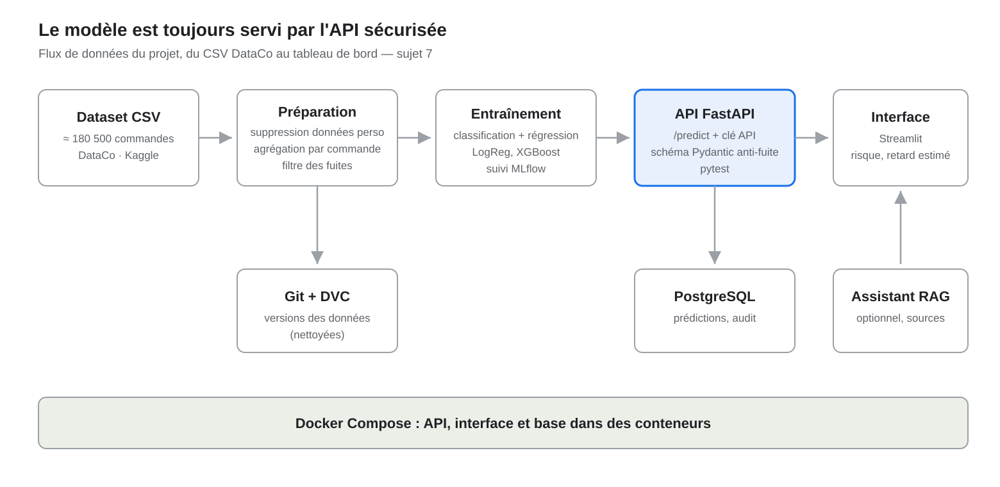

# Étude de conception — Prédiction de retard de livraison (Sujet 7, dataset DataCo)

Groupe : Baetouty Hibatallah, Sahia Abdelali, Iktache Chouaib, Zaki Rim, Haitam Salah-eddine · Version : finale · Date : 19/11/2026

## 1. Contexte et utilisateurs

- **Organisation ou situation :** une entreprise de e-commerce international (données DataCo Global : environ 180 500 commandes sur trois ans, 2015 à début 2018, livrées dans cinq marchés — Afrique, Europe, LATAM, Asie-Pacifique, USCA — selon quatre modes d'expédition : Standard, Second Class, First Class, Same Day). Plus de la moitié des commandes arrivent en retard par rapport au délai promis. Le projet prédit, dès la validation de la commande, le risque qu'elle soit livrée en retard, puis met à jour cette estimation à l'expédition, pour agir avant que le client ne subisse le retard.
- **Utilisateur principal (un rôle précis) :** le **responsable logistique e-commerce**, qui décide chaque jour quelles commandes accélérer (changement de mode d'expédition, traitement prioritaire en entrepôt) à partir de la liste des commandes triées par risque.
- **Utilisateurs secondaires :**

| Utilisateur | Besoin | Usage du système |
|---|---|---|
| Agent du service client | Prévenir le client avant la date promise | Risque et retard estimé (en jours) d'une commande |
| Gestionnaire d'entrepôt | Prioriser la préparation | File des commandes à risque du jour |
| Direction | Suivre la promesse de livraison par marché et mode | Taux de retard prédit vs réel |

## 2. Problème et décision

- **Décision que l'utilisateur prend avec le système :** pour chaque commande signalée « à risque », le responsable logistique décide de déclencher (ou non) une action corrective : passer à un mode d'expédition plus rapide, prioriser la préparation, ou faire prévenir le client par le service client. Le modèle produit une probabilité de retard transformée en alerte par un seuil réglable ; le système propose, l'humain décide.
- **Fréquence :** en continu à chaque validation de commande (plusieurs centaines par jour à l'échelle du dataset : ≈ 165 commandes/jour en moyenne), avec une revue quotidienne de la file des commandes à risque, et une mise à jour à chaque expédition.
- **Conséquence d'une erreur, et pour qui :**

| Erreur | Ce qui se passe | Coût, et pour qui |
|---|---|---|
| Faux négatif (retard non signalé) | Client non prévenu, promesse de livraison rompue | **Le plus élevé** : insatisfaction, remboursements de frais de port, perte du client |
| Faux positif (commande ponctuelle signalée) | Surclassement d'expédition ou traitement prioritaire inutile | Modéré : surcoût de transport, temps d'entrepôt |

Particularité de ce jeu de données : les retards sont **majoritaires** (≈ 55 %). Le coût unitaire d'un faux positif (surclassement payant) y est donc moins négligeable que dans un contexte où les alertes sont rares : le seuil est réglé sur le couple recall/précision de la classe « retard », pas sur le recall seul.

### 2.1. Deux moments de prédiction

| Moment | Ce qui est connu | Variante du modèle |
|---|---|---|
| A. Validation de la commande | Date, client (marché, région, pays), produit et catégorie, quantité, mode d'expédition choisi, délai promis (`Days for shipment (scheduled)`), type de paiement | Modèle principal |
| B. Expédition | Tout A + date réelle d'expédition, donc le délai de préparation en entrepôt (expédition − commande) | Mise à jour de l'alerte |

Les colonnes `Days for shipping (real)`, `Delivery Status` et `Late_delivery_risk` ne sont connues qu'à la livraison : `Late_delivery_risk` est la **cible**, et les deux autres en sont des réécritures directes (`Late_delivery_risk` = 1 exactement quand `Days for shipping (real)` > `Days for shipment (scheduled)`). Les utiliser comme variables d'entrée donnerait un score parfait et un modèle inutilisable : c'est le même piège de fuite d'information que sur tout dataset de livraison, et il est éliminé par construction du schéma d'entrée de l'API (variante A).

### 2.2. Exemple d'affichage (fictif)

Commande du 14 mars, marché LATAM, mode Second Class, délai promis 4 jours : risque de retard 71 %, retard estimé +1,5 jour (variante A). Après une expédition partie 2 jours après la commande : 88 % (variante B). Actions proposées : surclasser en First Class, prévenir le client. Ces valeurs illustrent l'interface et ne sont pas des résultats de modèle.

## 3. Approche par sous-problème

| Sous-problème | Approche (règles / ML / DL / LLM / RAG) | Pourquoi pas une approche plus simple |
|---|---|---|
| Prédire le retard à la validation de la commande | ML : classification supervisée (variante A) | La règle évidente « mode rapide = à l'heure » est fausse ici : les analyses publiques du dataset montrent que First Class et Same Day ont des taux de retard très élevés (promesse plus courte, donc plus souvent rompue). Il faut croiser mode, marché, délai promis et période : trop d'interactions pour des règles. |
| Estimer l'ampleur du retard | ML : régression sur (`real` − `scheduled`), en jours | Une moyenne historique par mode d'expédition donne le même chiffre à toutes les commandes d'un mode ; elle ne distingue ni le marché ni la période. C'est la baseline de la régression. |
| Mettre à jour l'alerte à l'expédition | ML : classification supervisée (variante B) | La règle « préparation > 2 jours → retard » ignore le délai promis et le mode ; elle sert de baseline à battre. |
| Fixer l'alerte | Règle : seuil choisi sur la validation | C'est déjà l'approche la plus simple : un seuil sur la probabilité, réglé selon le coût des erreurs. |
| Expliquer une prédiction | ML : importance des variables, SHAP | Nécessaire pour justifier un surclassement payant auprès du responsable ; des coefficients globaux n'expliquent pas une commande précise. |
| Prioriser les commandes | Règles : score de risque × valeur de la commande | Volontairement simple : un tri suffit, le ML n'apporte rien de plus ici. |
| Segmenter les flux | ML non supervisé : clustering (K-means) des couples marché × mode par profil de retard | Un découpage manuel de 5 marchés × 4 modes × plusieurs dizaines de catégories de produits est arbitraire ; le clustering objective les segments. |
| Présenter les résultats | Interface : tableau de bord Streamlit | Un export CSV ne permet ni tri interactif, ni filtres, ni détail d'une commande. |
| Retrouver les procédures logistiques | RAG optionnel (+2) : index vectoriel + LLM, réponses avec sources | Une recherche par mot-clé ne répond pas aux questions en langage naturel et ne cite pas ses sources. |

### 3.1. Modèles (échelle de complexité appliquée)

- **Baselines (règles)** : classe majoritaire (« tout en retard », ≈ 55 %) ; taux historique de retard par mode d'expédition et par marché ; pour la régression, la moyenne historique du retard par mode ; pour B, la règle « préparation > 2 jours ».
- **Logistic Regression / régression linéaire** : références interprétables.
- **Random Forest** : interactions non linéaires (mode × marché × délai promis).
- **XGBoost ou LightGBM** : performance sur tabulaire avec catégorielles nombreuses (pays, catégories de produits).
- Pas de deep learning : données tabulaires de taille moyenne, où le gradient boosting fait référence ; pas de LLM pour la prédiction elle-même.

## 4. Données

| Jeu de données | Source et licence | Volume | Données personnelles ? |
|---|---|---|---|
| DataCo Smart Supply Chain (`DataCoSupplyChainDataset.csv`) | Kaggle (shashwatwork) — licence **CC0 : domaine public** ; source originale : Mendeley Data, DOI 10.17632/8gx2fvg2k6.5 (Constante, Silva, Pereira), licence **CC BY 4.0**, citée dans le rapport. Licences vérifiées le 11/11/2026. | ≈ 180 500 lignes × 53 colonnes, commandes de 2015 à début 2018, 5 marchés | **Oui** (fictives) : noms, e-mails et mots de passe masqués, adresses, géolocalisation des clients → colonnes supprimées dès l'ingestion (voir sections 4.2 et 8) |
| `DescriptionDataCoSupplyChain.csv` | Même source | Dictionnaire des 53 variables | Non |
| `tokenized_access_logs.csv` (clickstream) | Même source | Logs de navigation | Hors périmètre (non utilisé) |
| Procédures logistiques (RAG optionnel) | Corpus fictif rédigé par le groupe | Quelques dizaines de pages | Non : documents fictifs |

### 4.1. Variables et disponibilité au moment de la prédiction

| Variable | Description | Type | Connue à la validation ? | Décision |
|---|---|---|---|---|
| `order date (DateOrders)` | Date de la commande | Date | Oui | Gardée → jour de semaine, mois, année (découpage temporel) |
| `Days for shipment (scheduled)` | Délai de livraison promis (jours) | Entière | Oui | Gardée (variable centrale) |
| `Shipping Mode` | Standard / Second / First Class / Same Day | Catégorielle (4) | Oui | Gardée, one-hot |
| `Market`, `Order Region`, `Order Country` | Destination de la commande | Catégorielles | Oui | Gardées ; pays encodé par fréquence (forte cardinalité) |
| `Category Name`, `Department Name` | Produit commandé | Catégorielles | Oui | Gardées |
| `Order Item Quantity`, `Sales`, `Order Item Total` | Taille et valeur de la commande | Numériques | Oui | Gardées |
| `Type` | Type de paiement | Catégorielle | Oui | Gardée |
| `Customer Segment` | Consumer / Corporate / Home Office | Catégorielle | Oui | Gardée |
| `shipping date (DateOrders)` | Date réelle d'expédition | Date | Non : connue à l'expédition | Variante B seulement (→ délai de préparation) |
| `Days for shipping (real)` | Délai de livraison réel (jours) | Numérique | Non : connue à la livraison | **Exclue des entrées** ; sert à construire la cible de régression (`real` − `scheduled`) |
| `Delivery Status` | Advance / On time / Late / Canceled | Catégorielle | Non : connue à la livraison | **Exclue des entrées** ; sert au filtrage des annulées |
| `Late_delivery_risk` | Commande livrée en retard (0/1) | Cible binaire | — | **Cible** de la classification |
| Noms, e-mails, mots de passe, adresses, latitude/longitude, codes postaux clients | Identité et localisation précise du client | Personnelles | — | **Supprimées à l'ingestion** (aucune utilité prédictive au-delà du marché/région, déjà gardés) |
| `Benefit per order`, `Order Profit`, statuts de paiement détaillés | Comptabilité de la commande | Numériques | Partiellement | Exclues : sans lien causal avec le transport, risque de corrélations fallacieuses |

### 4.2. Qualité des données

- Commandes au statut `Shipping canceled` (et paiements suspectés de fraude annulés) : retirées de l'entraînement — une commande annulée n'a pas de livraison, donc pas d'étiquette de retard valable.
- Colonnes personnelles (noms, e-mails et mots de passe déjà masqués « XXXXXXXXX » dans le fichier, adresses, géolocalisation) : supprimées dès l'ingestion, avant tout commit DVC.
- Dates au format texte converties en datetime ; variables dérivées : jour de semaine, mois, délai de préparation (variante B).
- Doublons d'`Order Id` (une ligne par article) : la prédiction se fait au niveau de la **commande** ; agrégation des lignes articles (quantité totale, valeur totale, catégorie principale).
- Hypothèse retenue : `Late_delivery_risk` (= `real` > `scheduled`) est pris comme vérité terrain du retard, conformément au dictionnaire des variables fourni avec le dataset.

### 4.3. Classes, volume et exploration prévue

Répartition rapportée par les analyses publiques du dataset : **≈ 55 % de commandes en retard, 45 % à l'heure ou en avance** — classes quasi équilibrées, le retard étant légèrement majoritaire. Volume : ≈ 180 500 lignes articles, soit nettement moins après agrégation par commande ; l'entraînement se fait sur la totalité, sans échantillonnage. Exploration menée en semaine 1 : taux de retard par mode d'expédition, marché, catégorie et mois ; distribution du retard en jours (`real` − `scheduled`) ; effet du délai promis ; vérification de la fuite (`Days for shipping (real)`, `Delivery Status`) ; étape non supervisée (clustering des segments marché × mode).

## 5. Métriques, baseline et critères d'acceptation

- **Baseline et son résultat :**
  - Classe majoritaire « tout en retard » : accuracy ≈ **55 %** (part rapportée des retards), recall(retard) = 100 % mais précision ≈ 55 % — inutilisable : elle déclencherait une action corrective payante sur toutes les commandes.
  - Baseline métier à battre : taux historique de retard par mode d'expédition × marché, calculé sur l'entraînement (2015–2016) et évalué sur le test temporel ; pour la régression, moyenne historique du retard par mode ; pour la variante B, la règle « préparation > 2 jours ».
- **Métrique principale et pourquoi :** **F1 de la classe « retard »** (recall et précision détaillés à côté, plus ROC-AUC). Les classes étant quasi équilibrées (≈ 55/45), le F1 reflète directement l'arbitrage coût du faux négatif (client perdu) / coût du faux positif (surclassement payant) décrit en section 2 ; le recall seul pousserait vers la baseline « tout en retard ».

| Métrique | Rôle |
|---|---|
| F1 (classe retard) | Métrique principale : équilibre détection / fausses alertes |
| Recall (classe retard) | Part des retards réels détectés |
| Precision (classe retard) | Part des alertes justifiées |
| ROC-AUC | Qualité globale, classes quasi équilibrées |
| MAE (régression, en jours) | Erreur moyenne sur l'ampleur du retard |
| Matrice de confusion + coût | Retards manqués et surclassements inutiles |

- **Protocole d'évaluation :** découpage **temporel** par date de commande — entraînement : 2015–2016 ; validation : premier semestre 2017 ; test : second semestre 2017 et début 2018 — qui reproduit l'usage réel et expose le modèle à la dérive dans le temps. Seuil d'alerte choisi sur la validation ; le test n'est utilisé qu'une fois. Chaque essai enregistré dans MLflow, données versionnées avec DVC (après suppression des colonnes personnelles).
- **Critères d'acceptation (un nombre, un jeu de données, une condition)** — chacun est testable sur le test temporel, défini une fois pour toutes :
  - ☐ Variante A : F1(retard) ≥ **0,75** et supérieur d'au moins **+0,05** à la baseline « taux historique par mode × marché », sur le **test temporel (S2 2017–début 2018)**.
  - ☐ Régression : MAE ≤ **1,5 jour** sur le test temporel, et inférieure à la baseline « moyenne par mode ».
  - ☐ Variante B : F1(retard) ≥ **0,80** sur le test temporel, et supérieur à la variante A (gain de l'information d'expédition mesuré et expliqué).
  - ☐ Aucune variable post-livraison (`Days for shipping (real)`, `Delivery Status`) ni personnelle dans le schéma d'entrée de l'API (vérifié par un test pytest).
  - ☐ L'interface affiche le risque, le retard estimé en jours, la variante utilisée, les variables connues, la version du modèle et l'heure de calcul.
  - ☐ API documentée (OpenAPI), sécurisée, testée (pytest) ; déploiement Docker ; rapport de validation.

## 6. Architecture prévue (après la séance 5)

Toute prédiction passe par l'API, qui valide l'entrée (schéma sans variables post-livraison ni personnelles), choisit la variante A ou B selon les données fournies et journalise le résultat.



```
Dataset CSV ──> Préparation ──> Entraînement ──> API FastAPI ──> Interface Streamlit
(≈180 500       (suppression    (classif. +      (/predict,      (file des commandes
 commandes,      données perso,  régression,      clé API,         à risque, retard
 DataCo/Kaggle)  agrégation,     suivi MLflow)    Pydantic,        estimé, facteurs)
                 filtre fuites)                   pytest)
                    │                                │            Assistant RAG
                    v                                v            (optionnel, sources)
               Git + DVC                        PostgreSQL
               (versions des données)           (prédictions, audit)

        [ Docker Compose : API, interface et base dans des conteneurs ]
```

### 6.1. Procédure de déploiement

1. Cloner le dépôt, puis `dvc pull` pour récupérer les données nettoyées et le modèle versionnés.
2. Entraîner et enregistrer les modèles (classification + régression) dans MLflow (`make train`), ou charger la dernière version validée.
3. Lancer `docker compose up` : API, interface et base PostgreSQL.
4. Vérifier `/health` et la documentation `/docs` de l'API, puis lancer `pytest`.
5. Nouvelle version du modèle : validation sur le test temporel, promotion dans MLflow, redémarrage de l'API. Retour arrière possible vers la version précédente.

## 7. Choix technologiques (après la séance 5)

| Besoin | Outil | Justification |
|---|---|---|
| Analyse des données | Python, pandas, NumPy, Matplotlib | Exploration de 180 500 lignes × 53 colonnes |
| Machine Learning | scikit-learn, XGBoost ou LightGBM, SHAP | Classification + régression tabulaires et explicabilité |
| Prétraitement sans fuite | Pipeline scikit-learn | Encodages appris sur l'entraînement seulement ; exclusion structurelle des colonnes post-livraison |
| Suivi | Git, DVC, MLflow | Versions des données (nettoyées des colonnes personnelles), des expériences et des modèles |
| API | FastAPI, Pydantic | Endpoint `/predict` validé — le schéma Pydantic refuse toute variable post-livraison ; documentation OpenAPI |
| Sécurité | Clé API ou JWT, limite de débit | Accès réservé, abus limités |
| Tests | pytest | Prétraitement, modèles et API (dont test anti-fuite du schéma) |
| Interface | Streamlit | Tableau de bord rapide à construire |
| Base de données | PostgreSQL | Commandes, prédictions et décisions |
| Déploiement | Docker, Docker Compose | Lancement reproductible |
| RAG optionnel (+2) | Index vectoriel + LLM | Procédures logistiques fictives, réponses avec sources |

## 8. Risques, éthique, confidentialité

1. **Les données contiennent-elles des données personnelles ? Lesquelles ?** Oui, fictives mais présentes : noms et prénoms des clients, e-mails et mots de passe (masqués dans le fichier), adresses, codes postaux, latitude/longitude.
2. **Peut-on s'en passer ou les anonymiser ?** Oui, totalement : ces colonnes sont supprimées dès l'ingestion, avant tout versionnage DVC. La prédiction n'utilise que le marché, la région et le pays, qui ne sont pas identifiants.
3. **Qui peut être lésé par une erreur ?** Les clients (retard non annoncé), l'entreprise (surclassements inutiles, remboursements), et certains marchés entiers si le modèle y est systématiquement moins fiable (voir question 4).
4. **Les données couvrent-elles tous les cas d'usage (lieux, périodes, populations) ?** Partiellement : trois ans et cinq marchés, ce qui couvre la saisonnalité annuelle — mais les volumes par marché sont inégaux, et des pays peu représentés auront des prédictions moins fiables ; c'est une entreprise fictive unique, au catalogue limité (articles de sport, vêtements, électronique).
5. **Quelle erreur coûte le plus, et à qui ?** Le faux négatif (client perdu, promesse rompue) ; mais le faux positif a ici un coût réel (surclassement payant), d'où un seuil réglé sur le F1 et non sur le recall seul.
6. **Qui valide les décisions, et peut les corriger ?** Le responsable logistique : le système propose un surclassement ou une priorisation, l'humain décide et note l'action prise.
7. **Des données sortent-elles de l'organisation (API externe) ?** Non par défaut. Un LLM externe pour le RAG ne reçoit que les procédures, jamais les commandes ni aucune donnée client.
8. **Comment le système pourrait-il être détourné ?** Requêtes massives sur l'API ; manipulation des priorités d'entrepôt ; usage du score pour discriminer des marchés ou refuser des ventes dans certaines régions. Mesures : authentification, validation des entrées, limite de débit, journal d'audit, et suivi du taux d'alerte par marché pour détecter un biais géographique.

## 9. Limites et hors périmètre

- Entreprise fictive : les volumes, délais et taux de retard (≈ 55 %) ne se transposent pas tels quels à une vraie chaîne logistique.
- Granularité en **jours entiers** (`scheduled` et `real`) : pas de prédiction à l'heure près — contrepartie de la disponibilité du retard réel, qui permet ici la régression.
- Données arrêtées début 2018 ; pas de météo, de trafic ni de suivi transporteur.
- Volumes inégaux entre marchés : fiabilité moindre sur les pays peu représentés (suivi du biais prévu en question 8).
- **Hors périmètre** : optimisation des tournées, choix automatique du mode d'expédition (le système propose, l'humain décide), détection de fraude (colonnes de paiement exclues), exploitation du clickstream (`tokenized_access_logs.csv`), ré-entraînement automatique en production.
- Licences : CC0 sur la copie Kaggle, CC BY 4.0 sur la source Mendeley — la source originale (Constante, Silva, Pereira, DOI 10.17632/8gx2fvg2k6.5) est citée dans le rapport, condition du CC BY.

---

### Planning indicatif

- Semaine 1 : exploration, suppression des colonnes personnelles, agrégation par commande, filtrage des annulées, vérification de la fuite, baselines.
- Semaine 2 : modèles A et B (classification) + régression du retard en jours, découpage temporel, choix du seuil, MLflow et DVC.
- Semaine 3 : API FastAPI sécurisée (schéma anti-fuite), tests, PostgreSQL.
- Semaine 4 : interface Streamlit, Docker Compose, RAG optionnel.
- Semaine 5 : rapport de validation et soutenance.

### Sources

- Dataset « DataCo Smart Supply Chain for Big Data Analysis » sur Kaggle (Shashwat Tiwari) — licence CC0, consultée le 11/11/2026.
- Source originale : Constante, Silva, Pereira — Mendeley Data, DOI 10.17632/8gx2fvg2k6.5, licence CC BY 4.0.
- Dictionnaire des variables : `DescriptionDataCoSupplyChain.csv` (fourni avec le dataset).
- Analyses publiques du dataset (répartition ≈ 55 % de retards, taux par mode d'expédition) : notebooks d'analyse exploratoire publiés sur Kaggle ; ces chiffres sont recalculés sur nos propres données lors de l'exploration de la semaine 1.
